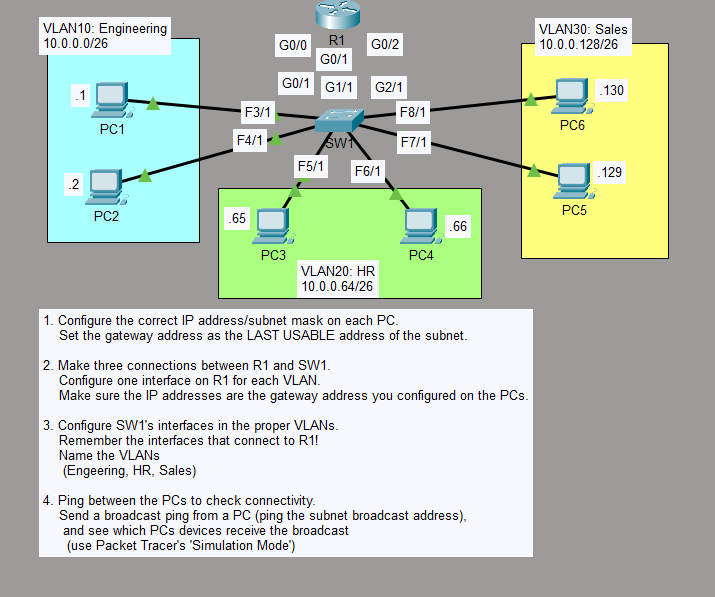

# Day 16: VLANs (Virtual Local Area Networks)

## lab Overview
This lab covers the configuration and verification of VLANs on Cisco Catalyst switches, separating broadcast domains and assigning access ports to designated VLANs.

## Topology


## objectives
- Create and name VLANs according to lab requirements.
- Assign switch access ports to the appropriate VLANs.
- Verify VLAN database and port membership.
- Test connectivity between hosts in the same and different VLANs.

## VLAN & Port Assignment Table
| Device | Interface | VLAN ID | VLAN Name | Subnet |

| SW1 | Fa3/1 , Fa4/1 , G0/1 | 10 | Engineering | 10.0.0.0/26 |
| SW1 | Fa5/1 , Fa6/1 , G1/1 | 20 | HR | 10.0.0.64/26 |
| SW1 | Fa7/1 , Fa8/1 , G2/1 | 30 | Sales | 10.0.0.128 |

## Verification Commands
```bash
show vlan brief

VLAN Name                             Status    Ports
---- -------------------------------- --------- -------------------------------
1    default                          active    Fa7/1, Fa9/1
10   Engineer                         active    Gig0/1, Fa3/1, Fa4/1
20   HR                               active    Gig1/1, Fa5/1, Fa6/1
30   Sales                            active    Gig2/1, Fa8/1
1002 fddi-default                     active    
1003 token-ring-default               active    
1004 fddinet-default                  active    
1005 trnet-default                    active

