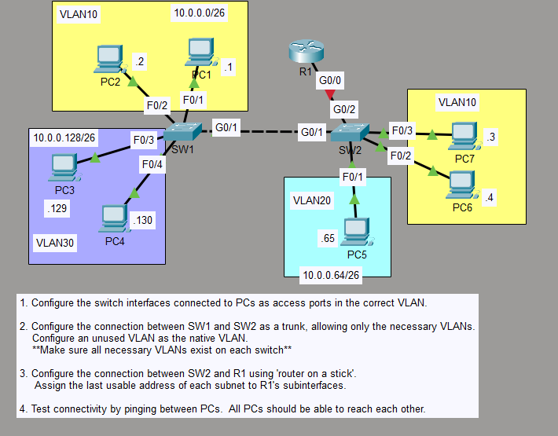

# Day 17: VLANs & Trunking (802.1Q & Native VLAN)

## Lab Overview
This lab demonstrates configuring and verifying 802.1Q trunk links between Cisco Catalyst switches, configuring allowed VLAN lists, and changing the default Native VLAN to enhance network security.

## Topology


## Objectives
- Configure 802.1Q trunking on inter-switch interfaces.
- Modify the Native VLAN from default VLAN 1 to a dedicated VLAN.
- Restrict allowed VLANs traversing the trunk link.
- Verify trunk encapsulation and native VLAN matching using CLI verification commands.

## Key Verification Commands
```text
show interfaces trunk
SW2#sh int tr
Port        Mode         Encapsulation  Status        Native vlan
Gig0/1      on           802.1q         trunking      99
Gig0/2      on           802.1q         trunking      99

Port        Vlans allowed on trunk
Gig0/1      10,30
Gig0/2      10,20,30,99

Port        Vlans allowed and active in management domain
Gig0/1      10,30
Gig0/2      10,20,30

Port        Vlans in spanning tree forwarding state and not pruned
Gig0/1      10,30
Gig0/2      10,20,30

show vlan brief
SW2#show vlan br

VLAN Name                             Status    Ports
---- -------------------------------- --------- -------------------------------
1    default                          active    Fa0/4, Fa0/5, Fa0/6, Fa0/7
                                                Fa0/8, Fa0/9, Fa0/10, Fa0/11
                                                Fa0/12, Fa0/13, Fa0/14, Fa0/15
                                                Fa0/16, Fa0/17, Fa0/18, Fa0/19
                                                Fa0/20, Fa0/21, Fa0/22, Fa0/23
                                                Fa0/24
10   VLAN0010                         active    Fa0/2, Fa0/3
20   VLAN0020                         active    Fa0/1
30   VLAN0030                         active    
1002 fddi-default                     active    
1003 token-ring-default               active    
1004 fddinet-default                  active    
1005 trnet-default                    active 
