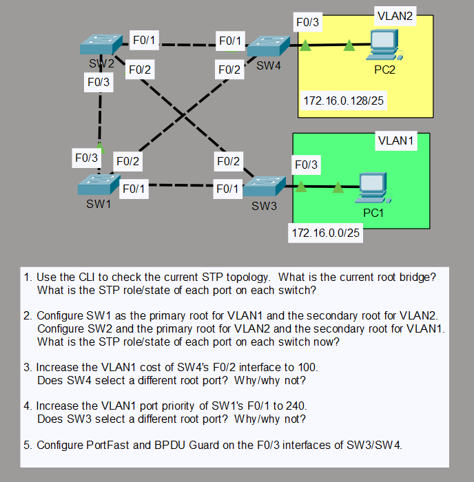

# Spanning Tree Protocol (STP) Configuration & Tuning

## Lab Overview
This lab explores Spanning Tree Protocol (STP / PVST+) behavior across a multi-switch topology. It covers root bridge election manipulation, secondary root redundancy, spanning-tree path cost and port-priority tuning, and securing edge access ports with PortFast and BPDU Guard.

## Topology


## Lab Tasks & Objectives
1. **STP Baseline Inspection:**
   - Inspect the default STP topology and identify the current Root Bridge and port roles/states (Root Port, Designated Port, Alternate/Blocking Port).
2. **Root Bridge Optimization (PVST+ Tuning):**
   - Configure **SW1** as the primary root bridge for VLAN 1 and secondary root for VLAN 2.
   - Configure **SW2** as the primary root bridge for VLAN 2 and secondary root for VLAN 1.
3. **Spanning Tree Path Cost Tuning:**
   - Increase the VLAN 1 cost of SW4's `FastEthernet0/2` interface to 100 to influence upstream path selection.
4. **Port Priority Manipulation:**
   - Modify the VLAN 1 port priority of SW1's `FastEthernet0/1` interface to 240.
5. **Edge Port Security & Convergence:**
   - Enable `spanning-tree portfast` and `spanning-tree bpduguard enable` on access interfaces connecting end hosts (`SW3 Fa0/3` and `SW4 Fa0/3`).

---

## Configuration Summary

### SW1 (Primary Root for VLAN 1, Secondary for VLAN 2)
```text
spanning-tree vlan 1 root primary
spanning-tree vlan 2 root secondary
interface FastEthernet0/1
 spanning-tree vlan 1 port-priority 240
