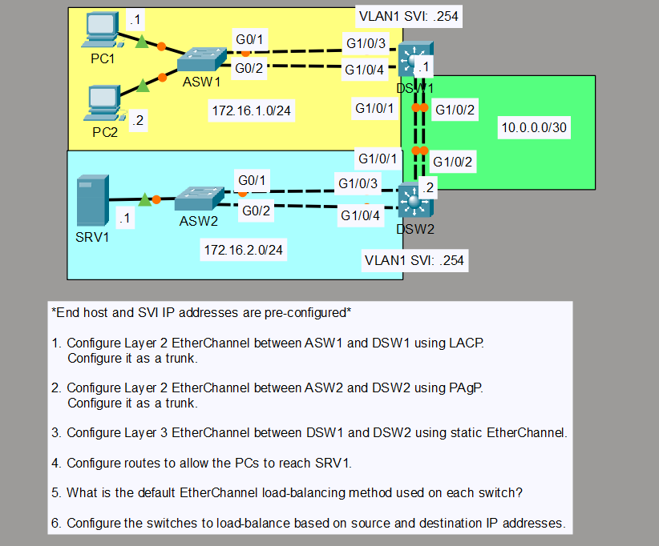

# CCNA Lab: EtherChannel Configuration & Tuning (LACP, PAgP, Layer 3 & Load-Balancing)

## Overview
This lab focuses on bundling multiple physical Ethernet links into a single logical link using EtherChannel. It covers Layer 2 EtherChannel using both standard LACP and Cisco-proprietary PAgP protocols, static Layer 3 EtherChannel (routed port-channel) with IPv4 addressing, inter-VLAN routing, and EtherChannel load-balancing configuration.

---

## Topology Diagram


---

## Addressing Table

| Device | Interface / SVI | IP Address | Subnet Mask | Default Gateway |
| :--- | :--- | :--- | :--- | :--- |
| **PC1** | NIC | `172.16.1.1` | `255.255.255.0` | `172.16.1.254` |
| **PC2** | NIC | `172.16.1.2` | `255.255.255.0` | `172.16.1.254` |
| **SRV1** | NIC | `172.16.2.1` | `255.255.255.0` | `172.16.2.254` |
| **ASW1** | Management | Pre-configured | Pre-configured | - |
| **ASW2** | Management | Pre-configured | Pre-configured | - |
| **DSW1** | `Vlan1` | `172.16.1.254` | `255.255.255.0` | - |
| **DSW1** | `Port-channel 12` | `10.0.0.1` | `255.255.255.252` | - |
| **DSW2** | `Vlan1` | `172.16.2.254` | `255.255.255.0` | - |
| **DSW2** | `Port-channel 12` | `10.0.0.2` | `255.255.255.252` | - |

---

## Lab Objectives

1. **Task 1: Layer 2 EtherChannel via LACP (ASW1 <-> DSW1)**
   - Bundle links `G0/1 - G0/2` on ASW1 and `G1/0/3 - G1/0/4` on DSW1 using LACP (`active` mode).
   - Configure the logical `Port-channel 1` interface as an 802.1Q trunk.

2. **Task 2: Layer 2 EtherChannel via PAgP (ASW2 <-> DSW2)**
   - Bundle links `G0/1 - G0/2` on ASW2 and `G1/0/3 - G1/0/4` on DSW2 using PAgP (`desirable` mode).
   - Configure the logical `Port-channel 2` interface as an 802.1Q trunk.

3. **Task 3: Layer 3 EtherChannel (DSW1 <-> DSW2)**
   - Turn physical links `G1/0/1 - G1/0/2` into routed ports (`no switchport`).
   - Bundle them statically (`mode on`) into `Port-channel 12`.
   - Assign the point-to-point subnet `10.0.0.0/30` to `Port-channel 12`.

4. **Task 4: IP Routing & Reachability**
   - Enable IP routing on multilayer switches `DSW1` and `DSW2`.
   - Configure static routes to allow traffic flow between `172.16.1.0/24` (PCs) and `172.16.2.0/24` (SRV1).

5. **Task 5 & 6: EtherChannel Load-Balancing**
   - Identify default load-balancing method (`Source MAC`).
   - Change load-balancing across all switches to use source and destination IP addresses (`src-dst-ip`).

---

## Configuration Commands

### ASW1 (Access Switch 1)
```ios
enable
configure terminal

! Configure LACP EtherChannel
interface range g0/1 - 2
 channel-group 1 mode active
 exit

! Configure Port-channel Trunk
interface port-channel 1
 switchport mode trunk
 exit

! Configure Load-Balancing
port-channel load-balance src-dst-ip
end
write memory
